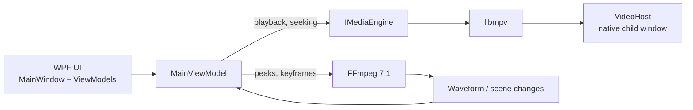

# VisualSubSync.NET

A faithful port of **VisualSubSync** — the subtitle synchronization tool originally written in
Delphi 7 and last released in 2013 — to **C# / .NET 10 / WPF**.

The project targets 1:1 parity with the original. The 2013 Delphi source defines *how the program
behaves*, and **VisualSubSync Enhanced 1.2.29** is the *visual* reference (layout, menus, texts,
tooltips, icons, shortcuts and colours). Neither the original nor the Enhanced sources are modified
by this project.

**Current version: `2.0.0-alpha.3`**

---

## Table of contents

- [Overview](#overview)
- [Features](#features)
- [Architecture](#architecture)
- [Tech stack](#tech-stack)
- [Requirements](#requirements)
- [Building, testing and running](#building-testing-and-running)
- [Publishing and installer](#publishing-and-installer)
- [User data and settings](#user-data-and-settings)
- [Media pipeline](#media-pipeline)
- [Documentation](#documentation)
- [Project status](#project-status)
- [Credits](#credits)

---

## Overview

VisualSubSync is a subtitle timing tool built around the audio waveform: the operator reads the
waveform, sees the audio peaks and scene changes, and nudges each subtitle into place. This port
reimplements that workflow on .NET while keeping the interface and the behaviour of the original
recognizable to anyone who used it.

Parity rules applied throughout the port:

| Rule | Description |
| --- | --- |
| Fidelity first | Interface, layout, texts, shortcuts, colours, behaviour, flow and file formats follow the original as closely as possible. |
| Behaviour from the 2013 source | The original `.pas`/`.dfm` sources are the authority for logic; the Enhanced only refines the visuals. |
| No silent omissions | Features not yet ported are shown in place, with the original caption, but disabled — never hidden. |
| Documented deviations | Every deliberate difference is small, justified and recorded in `docs/PLANO-DE-MIGRACAO.md`. |

## Features

- **Waveform-based synchronization** with audio peaks (computed by FFmpeg) and scene-change marks.
- **Subtitle formats:** SRT and SSA/ASS, including the original's conversion rules (centisecond
  rounding, comment lines discarded) and the SSA *timing mode*.
- **Import and export:** legacy projects and settings, plus CUE, TXT and CSV export.
- **Project files** (`.vssprj`) written as UTF-16 LE, matching the original byte layout.
- **Editing:** multi-selection, split/merge, styles, presets, find, go-to, delay, silent zones,
  vertical scaling and undo/redo.
- **Error checking plugins** in JavaScript (Jint), running the original `jsplugin/` scripts.
- **Spell checking** with Hunspell dictionaries (`dict/`).
- **VO / translation helper** and karaoke (SSA) timing support.
- **Built-in web server** that publishes the subtitle list for external suggestions.
- **Detached video window**, so the video can live on a second monitor.

## Architecture

The solution is split so that the domain logic stays testable and independent from the UI and from
the media binaries.

| Project | Target | Responsibility |
| --- | --- | --- |
| `src/VisualSubSync.App` | `net10.0-windows` | WPF application: views, view models (`MainViewModel` partials), dialogs, shell integration and the published executable. |
| `src/VisualSubSync.Core` | `net10.0` | Domain: subtitle formats, project and settings files, plugins, hotkeys, error checks, waveform model. |
| `src/VisualSubSync.Media` | `net10.0` | Media abstraction (`IMediaEngine`) over libmpv, plus FFmpeg-based audio peak and keyframe extraction. |
| `src/VisualSubSync.Waveform` | `net10.0-windows` | The waveform rendering control. |
| `tests/VisualSubSync.Core.Tests` | `net10.0` | Domain tests. |
| `tests/VisualSubSync.App.Tests` | `net10.0-windows` | View model and dialog tests (STA thread, fake dialogs and fake media engine). |
| `tests/VisualSubSync.Media.Tests` | `net10.0` | FFmpeg/libmpv integration tests using real libraries and synthetic audio. |

Interface code follows the original Delphi form definitions, including fixed metrics (`MainWindow`
geometry of 1083x755, 20 px menu bar, 21 px main tab header, 4 px tab content inset) so that the
layout matches the Enhanced build.

## Tech stack

| Component | Version | Role |
| --- | --- | --- |
| .NET | 10 (`10.0.100`) | Runtime and SDK. Warnings are treated as errors. |
| WPF | — | Desktop UI. |
| CommunityToolkit.Mvvm | 8.4.2 | MVVM source generators (`ObservableProperty`, `RelayCommand`). |
| libmpv | shinchiro build | Video playback, embedded through a native child window. |
| FFmpeg | 7.1 (`FFmpeg.AutoGen` 7.1.1, `Sdcb.FFmpeg.runtime.windows-x64` 7.1.0) | Audio peaks and keyframe extraction. |
| Jint | 4.17.0 | JavaScript engine for the error-checking plugins (replaces SpiderMonkey 1.5). |
| WeCantSpell.Hunspell | 7.0.1 | Spell checking (replaces `libhunspell.dll`). |
| xunit.v3 | 4.0.2 | Test framework, run through `Microsoft.Testing.Platform`. |

## Requirements

- Windows 10 or 11 (x64).
- .NET SDK 10.0.100 or later, with `rollForward: latestFeature` (see `global.json`).
- For publishing: `libmpv-2.dll`, fetched by `poc/obter-libmpv.ps1`.
- For the installer: **NSIS 3** (`makensis.exe`).

The published build is self-contained, so end users do not need a .NET runtime installed.

## Building, testing and running

```powershell
# Restore and build
dotnet build VisualSubSync.slnx -c Release

# Tests (249 total: 224 Core, 17 App, 8 Media)
dotnet test VisualSubSync.slnx -c Release

# Run against a project file, or with no argument
dotnet run --project src/VisualSubSync.App -- "C:\path\project.vssprj"
```

Passing an `.srt` file on the command line creates the matching `.vssprj` project next to it, the
same way the original does.

## Publishing and installer

```powershell
# 1) Publish the self-contained application
dotnet publish src/VisualSubSync.App -c Release -r win-x64 --self-contained -o publish/VisualSubSyncNET-win-x64

# 2) Build the installer from that publication
powershell -ExecutionPolicy Bypass -File installer/build-installer.ps1 -NoPublish
```

`build-installer.ps1` does the following:

1. Publishes the app (unless `-NoPublish` is given) to `publish/VisualSubSyncNET-win-x64`.
2. Verifies that `libmpv-2.dll` is present in the publication.
3. Cross-checks the published assembly version against `Directory.Build.props` and aborts on mismatch.
4. Regenerates `installer/files.nsh` from the publication contents.
5. Invokes NSIS, producing `installer/Redist/VisualSubSyncNET-<version>-Setup.exe`.

Useful parameters: `-NoPublish` (reuse an existing publication), `-PublishDirectory <path>`
(package a specific version folder), `-MakeNsis <path>` (NSIS in a non-default location).

The bundled `libmpv-2.dll` can be (re)fetched with:

```powershell
powershell -ExecutionPolicy Bypass -File poc/obter-libmpv.ps1
```

To bump a release, change `<Version>` in `Directory.Build.props` (`alpha.3` → `alpha.4` → … and
finally `2.0.0`); both the application and the installer pick it up.

## User data and settings

- **Settings:** `VisualSubSync.ini` next to the executable when that folder is writable; otherwise
  `%APPDATA%\VisualSubSync.ini`. During the first migration to the profile location, a protected
  local INI is read as the source.
- **Backups:** `Backup` next to the executable; if unavailable, `%APPDATA%\VisualSubSync\Backup`.
- **Dictionaries:** Hunspell files in `dict/`.
- Subtitle files, projects and the INI are written to a temporary file before replacing the previous
  one. Failures of the final backup or of the preferences are reported to the user.
- The application is portable: it does not search for its configuration or assets in folders above
  its own installation directory.

## Media pipeline



`IMediaEngine` isolates libmpv behind an interface so that playback can be replaced or faked in
tests. FFmpeg is invoked for audio peak detection and keyframe lists; peak computation requires a
full pass over the audio stream.

## Documentation

- [Project rules](docs/Visual_Projeto.md)
- [Migration plan and differences](docs/PLANO-DE-MIGRACAO.md)
- [Inventory of the original](docs/INVENTARIO.md)
- [Enhanced interface reference](docs/enhanced/README.md)
- [Parity audit (2026-10-21)](docs/AUDITORIA-PARIDADE-2026-10-21.md)
- [Parity traceability data](docs/RASTREABILIDADE-PARIDADE-2026-10-21.json)
- [Media measurements](docs/medicoes/)

The parity index can be regenerated with `python tools/audit-parity.py`.

## Project status

Milestones M0–M9 are implemented as described in the migration plan, with explicit validation
pending. Current state:

- Build: no warnings, no errors (`TreatWarningsAsErrors` is enabled).
- Tests: **249 passing** (224 Core, 17 App, 8 Media); 0 failures, 0 skipped.
- The App tests run on an STA thread with dialog and media substitutes.
- The Media tests use real FFmpeg/libmpv against synthetic audio and produce no audiovisual output.

Still to validate: the full subtitling workflow against real media, CFR/VFR/HEVC videos, DPI
scaling, the detached video window, and installation on clean Windows 10/11 systems. Visual parity
is not proven by the automated tests — it requires side-by-side comparison with the Enhanced build.

## Credits

VisualSubSync was created by **Christophe Paris** and released under the GNU GPL; this port keeps the
same licensing as the upstream project.

This port would not be possible without the following components:

| Component | Author / Project |
| --- | --- |
| mpv / libmpv | the mpv developers |
| FFmpeg | the FFmpeg developers |
| Jint JavaScript engine | Sébastien Ros |
| Hunspell (`WeCantSpell.Hunspell`) | László Németh |
| CommunityToolkit.Mvvm | the .NET Foundation |

**Maintained by:** Clediomar Santos (Hayllander) — geekcdtoys@gmail.com, kisifolda@gmail.com
**Project page:** http://legendasrt.com.br/VisualSubSyncNET/
